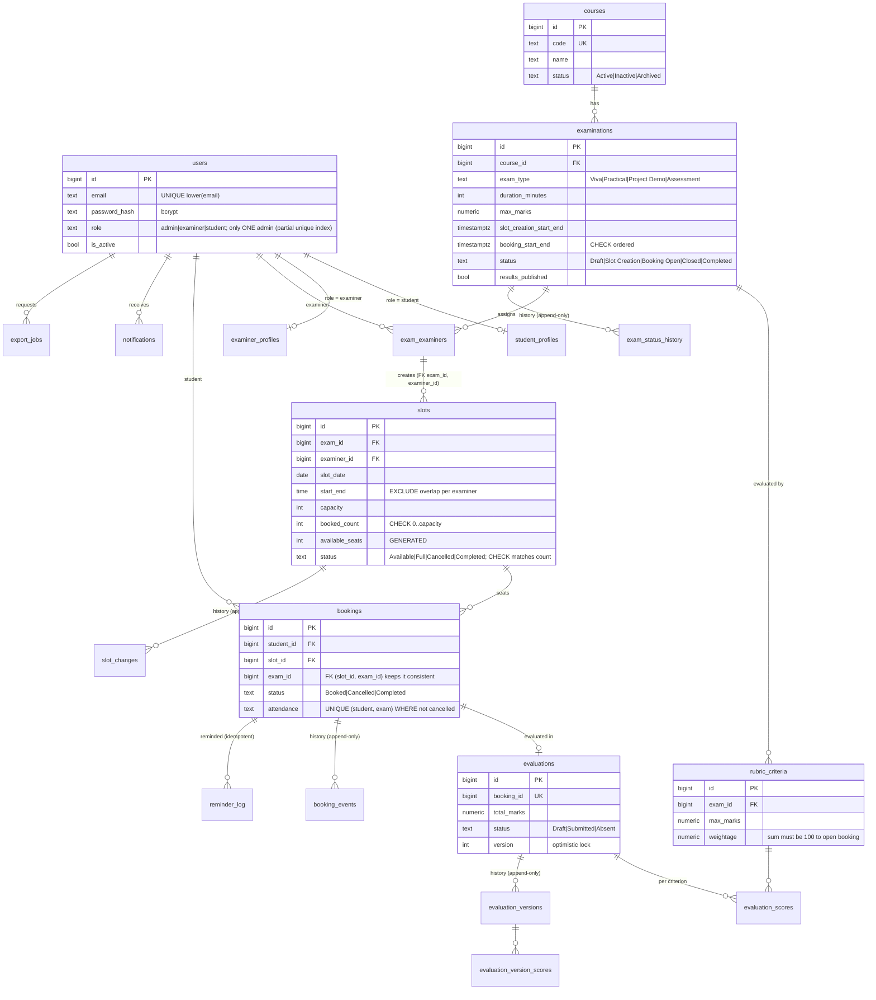

# Entity–relationship diagram

GitHub renders this Mermaid diagram directly. The full DDL, with every constraint, is in [`server/db/schema.sql`](../server/db/schema.sql).

## Normalisation notes

- The users table is **unified**. Role-specific data lives in `student_profiles` and `examiner_profiles`. Their composite foreign key `(user_id, user_role) → users(id, role)` makes it impossible to attach a student profile to an examiner.
- `bookings.exam_id` is the one deliberate denormalisation. It makes the partial unique index *one active booking per student per exam* possible. The composite foreign key `(slot_id, exam_id) → slots(id, exam_id)` guarantees it can never disagree with the slot.
- `slots.booked_count` is a counter, not the source of truth. The bookings are the source of truth. The counter is changed only inside the same locked transaction as the booking, and a `CHECK (booked_count <= capacity)` guards it. The tests assert `booked_count = count(active bookings)` after every race.
- No column holds lists or comma-separated values. Scores are rows in `evaluation_scores`, one per criterion.
